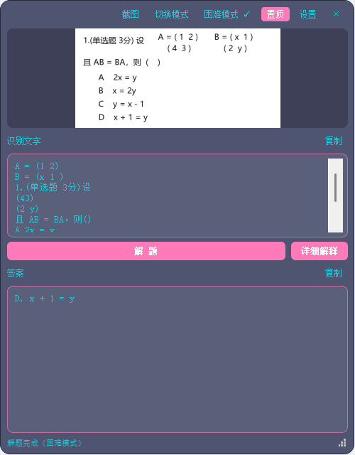

# 做题助手版（赵相机 · 扩展版）

截图 → 本地 OCR → 本地 / 云端模型**做题**，并保留原来的**翻译**能力。两者一键切换。

按 `Win + Shift + S` 框选一道题，点「解 题」就出答案；遇到行列式、矩阵这类 OCR 读不懂的题，点「困难模式」把截图直接交给云端视觉模型。



> 由 **赵相机** 扩展而来（本项目的翻译能力就是它的核心功能）。原项目专注截图翻译，这个版本加了「解题」模式。
> 原项目仓库：https://github.com/haoyihan17/zhaocamera

---

## 下载安装

到 [Releases](../../releases) 页面下载最新的 `赵相机做题助手_v1.0.1_安装包.exe`，双击安装即可。

- **不需要管理员权限**
- 自动创建桌面和开始菜单快捷方式
- 安装包**不含任何 API Key**，第一次打开会让你自己填

---

## 三个模型状态

| 状态 | 用什么 | 说明 |
| --- | --- | --- |
| **翻译模式** | 本地 `hy-mt2-1.8b`（1.13GB） | 主按钮「翻 译」 |
| **普通解题** | 本地 `qwen3-vl-8b-instruct`（5.78GB） | 主按钮「解 题」；自动判断喂文字还是喂图 |
| **困难模式** | **云端**（如 `glm-4.6v`） | 主按钮「解 题」；**强制把截图直接喂给云端模型**，不加载本地模型 |

- 「**切换模式**」：翻译 ↔ 解题
- 「**困难模式**」：普通 ↔ 困难（**只在解题模式下显示**）
- 切到需要本地模型的状态时会加载模型（约 10~30 秒）；**困难模式走云端，切换是瞬时的，还会把本地模型卸载掉释放内存**

> ⚠️ 本地模型很吃内存：实测 8B 单跑就只剩 0.75GB 内存。

---

## 使用流程

1. 按 `Win + Shift + S` 框选题目（或点「截图」用内置框选）。
2. 悬浮窗自动弹出并识别出文字。
3. 点「**解 题**」（或「翻 译」）。
4. 结果出现在下方「答案」区，可手动编辑、可一键复制。

### 解题的输出规则

| 题型 | 输出 |
| --- | --- |
| **选择题** | 只输出「选项字母. 选项内容」，例如 `C. 29`；同时**弹出「详细解释」按钮**，点它才展开完整解题过程 |
| **简答题 / 填空题** | 直接给精简答案（1-3 句）；若题目明确要求字数/步骤，则按要求作答 |

### 喂给模型的是什么

`设置 → 解题 → 喂给模型` 可选：

| 选项 | 行为 |
| --- | --- |
| **自动判断（默认）** | OCR 文字太少或数学符号密集 → 直接喂截图；否则只用 OCR 文字（更快） |
| 总是喂图片 | 公式、几何图、化学式、表格最准，稍慢 |
| 只用 OCR 文字 | 最快，但公式/图形会丢 |

### 困难模式（行列式 / 矩阵 / 复杂公式）

OCR 天生读不懂二维结构（行列式、矩阵、多重分式），转成文字必然崩。
**困难模式**直接把截图喂给**云端多模态模型**（如 `glm-4.6v`），让它自己看图。

实测同一道行列式题：

| 路线 | 结果 |
| --- | --- |
| 文字路线（OCR 后） | OCR 输出 `1 2 3 4` 结构全丢 → 模型答「缺少完整行列式结构，无法确定阶数」 |
| **困难模式（图片直喂）** | **4.0 秒 → `A. -2`** ✅ |

> 代价：云端推理模型更慢（复杂题 10~30 秒），但**不占本地内存**，切换也是瞬时的。

### 云端解题（可选）

设置 → 解题 → 解题后端 → **云端 API**，填地址和 Key，然后点
**「从云端拉取模型列表」**——程序会调 `GET {地址}/models`，把可用模型 ID 自动填进
「文字模型」「图片模型」两个下拉框。**不用自己猜模型名。**

| 字段 | 说明 |
| --- | --- |
| 云端 · 地址 | 见下表 |
| 云端 · API Key | 你自己的 Key |
| 云端 · 文字模型 | 纯文字题用，如 `deepseek-chat` |
| 云端 · 图片模型 | **必须能看图**（名字里通常带 `vl` / `v` / `vision`） |

**常用端点（都是 OpenAI 兼容）**

| 平台 | 地址 | 备注 |
| --- | --- | --- |
| 智谱 | `https://open.bigmodel.cn/api/paas/v4` | **`glm-4.6v-flash` 免费**，128K，多模态 |
| 阿里云百炼 | `https://dashscope.aliyuncs.com/compatible-mode/v1` | `qwen3-vl-plus`，262K |
| 火山方舟 | `https://ark.cn-beijing.volces.com/api/v3` | `doubao-1.5-vision-pro` |
| DeepSeek | `https://api.deepseek.com/v1` | ⚠️ **纯文字，看不了图** |

⚠️ **DeepSeek 的 `deepseek-chat` 看不了图**：文字题能用，图片题/困难模式必须换多模态模型。

**思考开关（很重要）**

同一道矩阵题、同一个 `glm-4.6v` 实测：

| 设置 | 耗时 | 答案 |
| --- | --- | --- |
| 关思考 | 1.4 秒 | ❌ `A. 2x = y`（错） |
| **开思考（默认）** | **9~25 秒** | ✅ `D. x + 1 = y` |

同一个模型，关掉思考就答错。所以默认**开着思考**（准确性优先）。
想极限提速可把 `config.json` 里 `cloud_fast_no_thinking` 改成 `true`，但复杂题会答错。

### 停止按钮

解题过程中「解题」按钮旁会出现「**停止**」。点它会立即断开连接（流式读取，
云端也会同步停止计费）。实测 5 秒内中断，中断后可正常再解题。

> 说明：大模型一旦开始生成无法真正「暂停再续」，只能停止重新开始。

---

## 运行

双击 `run.bat`。它会依次尝试：项目内 `.venv` → 环境变量 `ZHAO_PYTHON` → 构建目录里的 venv → 系统 `pythonw`。

> ⚠️ **路径要求**：pip 版 PyQt5 在**中文路径**下解析不到 Qt 插件，Python 环境要装在纯英文路径下
> （`build_exe.bat` 会自动建到脚本所在盘根目录，如 `D:\zhaocamera_solve_build`）。

或者直接下载 [Releases](../../releases) 里的安装包，免装 Python。

**前置条件（按模式不同）**

| 模式 | 需要什么 |
| --- | --- |
| 普通解题 | 装 [LM Studio](https://lmstudio.ai/)，下载 `qwen3-vl-8b-instruct`，启动本地服务（端口 1234） |
| 困难模式 | 一个能看图的云端模型 Key（默认配好智谱 `glm-4.6v`） |
| 翻译 | 以上任一即可；都没有也能用内置离线模型 |

程序会在需要时自动 `lms load` 对应模型。

---

## 设置项（新增部分）

| 设置 | 说明 |
| --- | --- |
| 解题模型（普通） | 默认 `qwen3-vl-8b-instruct`（本地） |
| 普通解题后端 | 本地 / 云端（**困难模式固定走云端**，不受此项影响） |
| 喂给模型 | 自动 / 总是图片 / 只用文字 |
| 解题后端 | 本地（LM Studio）/ 云端 API |
| 云端 · 地址 / Key / 文字模型 / 图片模型 | 云端解题用（图片模型必须能看图） |
| 翻译模型 | 默认 `hy-mt2-1.8b` |
| 本地 · API Token | LM Studio 鉴权 Token |

> 其余设置（配色、字体、透明度、置顶、OCR 引擎、云端 API 兜底等）与原项目一致。

---

## 已知限制

- 8B 模型占内存较多：跑题前建议关掉 QQ / 微信 / Edge / B站（能省 1.5~2GB）。
- 公式和图形靠视觉模型读，手写体或特别模糊的截图可能识别不准。
- 详细解释是一次额外请求，会多花几秒。

---

## 目录结构

```
赵相机（做题助手版）\
├── main.py               入口：托盘 + 剪贴板监听 + 截图调度
├── floating_window.py    悬浮窗（含「切换模式」「解题」「详细解释」）
├── solver.py             解题模块（模型管理 + 自动判断 + 解题 + 解释）
├── translator.py         翻译模块（本地/云端/离线三级兜底）
├── settings_window.py    设置窗口
├── capture.py            内置截图 + 图像转换
├── ocr.py / ocr_ps.ps1   RapidOCR / Windows OCR
├── config.py / config.json  配置
├── run.bat               一键运行
├── LICENSE               MIT 许可证
└── README.md             本文件
```

---

## 许可

[MIT License](LICENSE) —— 随便用、随便改、可以商用，保留版权声明即可。

---

## 关于图标

程序图标里的角色是《崩坏：星穹铁道》的 **三月七**，角色版权归 **miHoYo / 米哈游** 所有。

本项目的图标仅作为**同人作品**使用，遵循米哈游的同人创作规范；本项目与米哈游无任何关联，也未获得其背书。
若你是版权方并希望移除该素材，请联系我，会立即更换。

---

## 致谢

- [RapidOCR](https://github.com/RapidAI/RapidOCR) —— 深度学习 OCR
- [LM Studio](https://lmstudio.ai/) —— 本地大模型运行时
- [智谱开放平台](https://open.bigmodel.cn) / [阿里云百炼](https://help.aliyun.com/zh/model-studio/) —— 云端多模态模型
